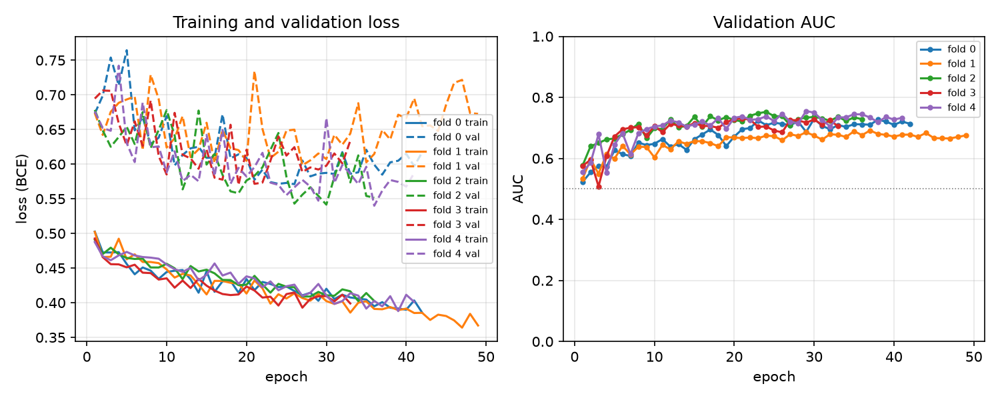
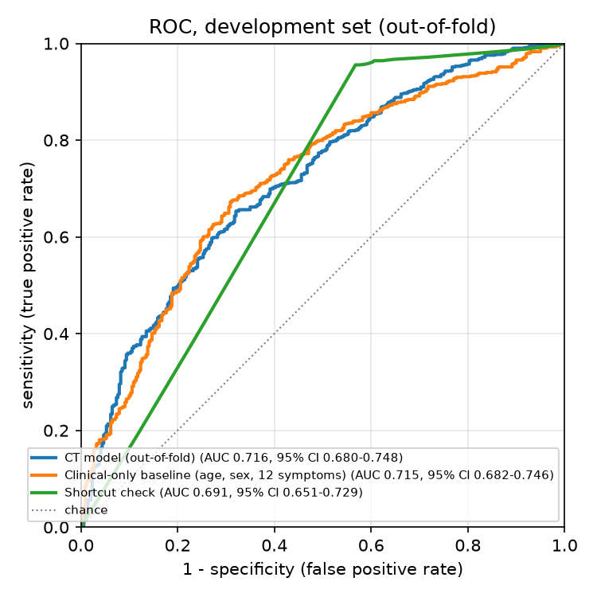
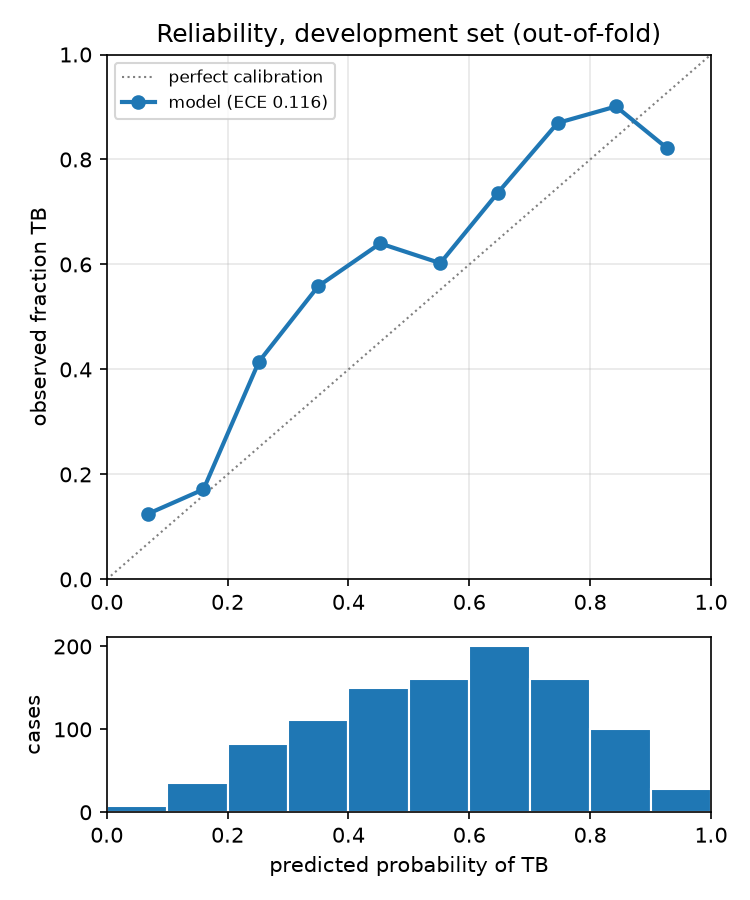
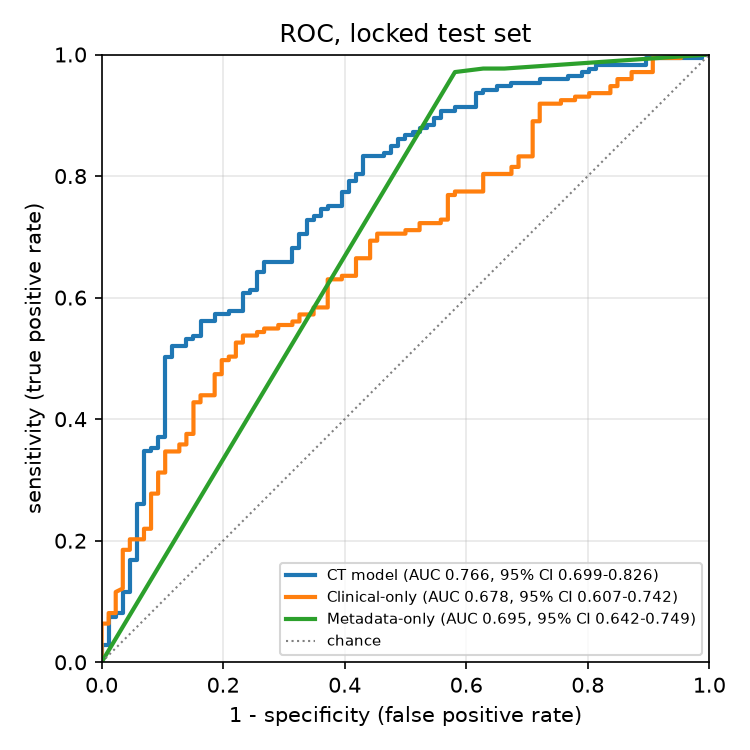
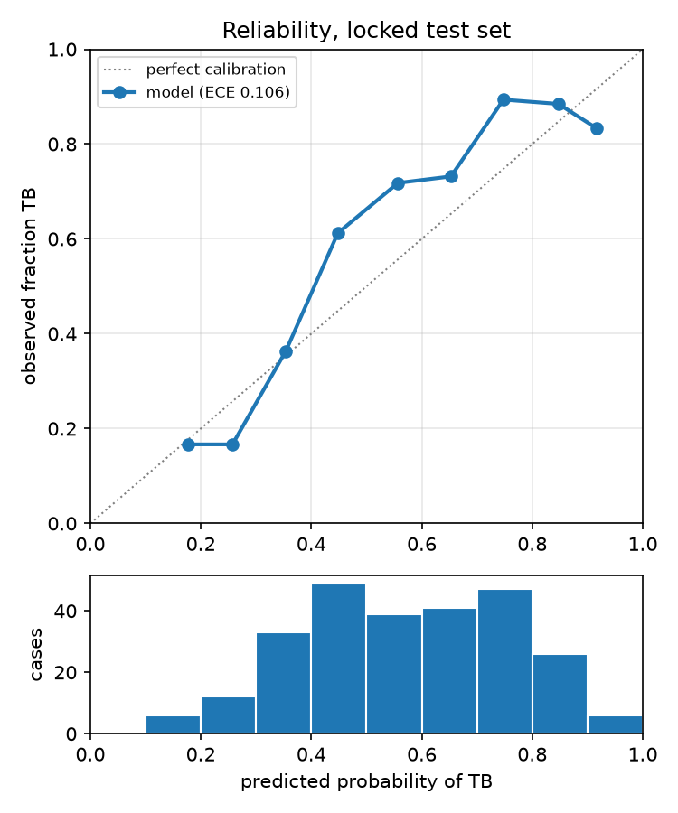
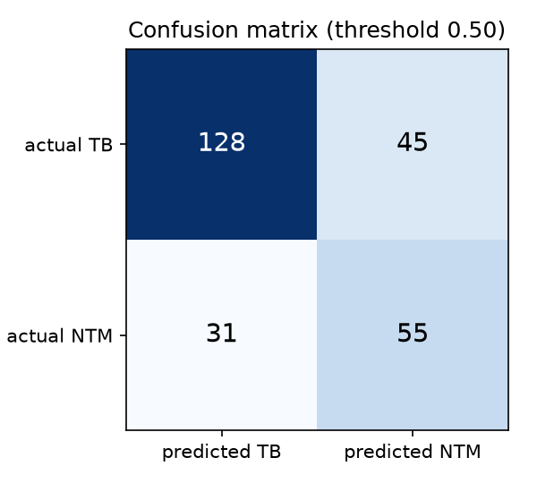
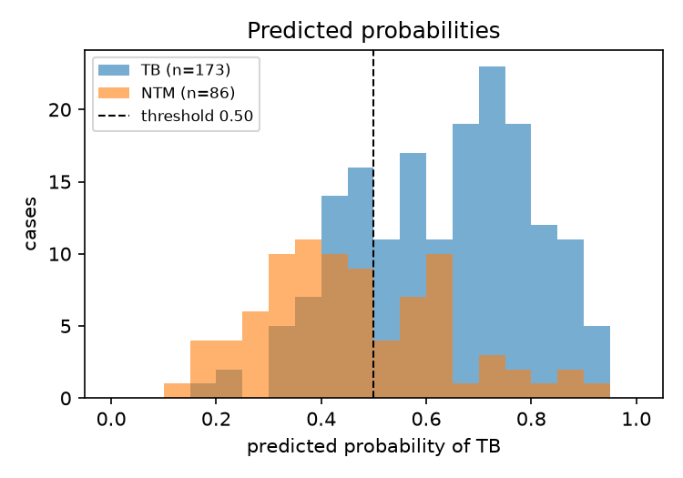
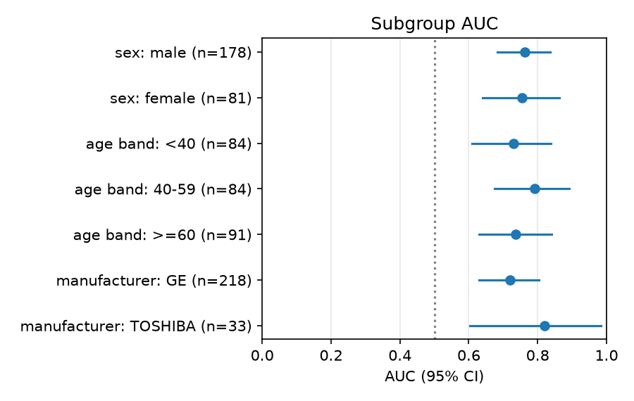

# CaviNet evaluation report

> Generated by `cavinet-ml evaluate` on 2026-10-17T12:14:26+00:00 (toolkit 0.9.0, git `87706aca72ace8e5f9ef8f9d79c8b87312985947`). Do not edit by hand.

## Summary

| Question | Result |
|---|---|
| H1: the CT model separates TB from NTM better than chance | **Supported**. Test AUC 0.766 (95% CI 0.699 to 0.826); supported if the lower bound is above 0.50. Target AUC ≥ 0.75: met. |
| H2: CT adds information beyond demographics and symptoms | **Supported**. CT AUC 0.766 vs clinical-only AUC 0.678 on the same 259 patients: difference +0.088 (95% CI +0.004 to +0.173), DeLong p = 0.0409; supported if the CT model is better with p < 0.05. |
| Shortcut check (locked test set) | WARNING: scan metadata alone separates TB from NTM (AUC 0.695, CI lower bound 0.642 > 0.50). The CT model may partly learn scanner differences; report this. |
| Cross-validation (development set) | Pooled out-of-fold AUC 0.716 (0.680 to 0.748) on 1038 patients. |

## Data

- Patients in the manifest: 1301; excluded before splitting: 4.
- Development set: 1038 patients (698 TB, 340 NTM) in 5 folds of 208, 208, 208, 207, 207.
- Locked test set: 259 patients (173 TB, 86 NTM), 20.0% of the usable patients, stratified by label × sex × age_band × manufacturer_group, seed 42.

Excluded patients:

| Patient | Reason |
|---|---|
| Case_226 | not listed in PatientIndex.xlsx |
| Case_227 | not listed in PatientIndex.xlsx |
| Case_252 | listed more than once in PatientIndex.xlsx with different values |
| Case_253 | listed more than once in PatientIndex.xlsx with different values |

## Cross-validation (development set)

| Fold | Patients | Out-of-fold AUC |
|---|---|---|
| 0 | 208 | 0.730 |
| 1 | 208 | 0.691 |
| 2 | 208 | 0.753 |
| 3 | 207 | 0.731 |
| 4 | 207 | 0.755 |

- Pooled out-of-fold AUC: 0.716 (0.680 to 0.748).
- Calibration (temperature scaling, T = 1.1952): expected calibration error 0.110 before, 0.116 after; Brier score 0.206 before, 0.205 after.
- Youden-optimal threshold on the development set: 0.555 (reported for reference; the application uses 0.50).
- Clinical-only baseline (age, sex, 12 symptoms): out-of-fold AUC 0.715 (0.682 to 0.746); CT minus this model +0.000 (95% CI -0.042 to +0.042), DeLong p = 0.9883.
- Shortcut check: metadata-only model (manufacturer, kernel, slice thickness): out-of-fold AUC 0.691 (0.651 to 0.729); CT minus this model +0.024 (95% CI -0.024 to +0.072), DeLong p = 0.3248.
  WARNING: scan metadata alone separates TB from NTM (AUC 0.691, CI lower bound 0.651 > 0.50). The CT model may partly learn scanner differences; report this.

## Locked test set

Evaluated on 2026-10-17T12:14:25+00:00 (run 1) with `cavinet_model.pth` (CaviNet TB vs NTM ensemble, version model-v1, trained 2026-10-17T12:02:45+00:00); file SHA-256 `d05db3a139ddeb22843140f5e82146468ef8f15e91b1131721b2b09ae71d3748`, weights SHA-256 `00a92c099209ae34bbd016a15f0941c9a0300a4ca77acab64fd1ed63a23cf6bc`.

259 patients (173 TB, 86 NTM). Threshold 0.50 (the application's).

| Metric | Value (95% CI) |
|---|---|
| AUC | 0.766 (0.699 to 0.826) |
| Sensitivity (TB) | 74.0% (67.6% to 80.3%) |
| Specificity (NTM) | 64.0% (53.5% to 73.3%) |
| PPV | 80.5% (75.9% to 85.2%) |
| NPV | 55.0% (47.6% to 62.5%) |
| Accuracy | 70.7% (64.9% to 76.1%) |
| Balanced accuracy | 69.0% (62.9% to 74.8%) |
| F1 | 0.771 (0.723 to 0.815) |
| Brier score | 0.189 (0.171 to 0.208) |
| Expected calibration error | 0.106 (0.092 to 0.154) |

AUC 95% CI by DeLong's method, for reference: 0.704 to 0.828.

| | Predicted TB | Predicted NTM |
|---|---|---|
| Actual TB | 128 | 45 |
| Actual NTM | 31 | 55 |

At the Youden-optimal threshold chosen on the development set (0.555): sensitivity 66.5% (59.0% to 73.4%), specificity 68.6% (58.1% to 77.9%), balanced accuracy 67.5% (61.2% to 73.6%).

### Clinical-only baseline and shortcut check

Both models were fitted on the whole development set and applied once to the same test patients.

| Model | Test AUC (95% CI) | CT minus model (95% CI) | DeLong p |
|---|---|---|---|
| Clinical-only baseline (age, sex, 12 symptoms) | 0.678 (0.607 to 0.742) | +0.088 (95% CI +0.004 to +0.173) | 0.0409 |
| Shortcut check: metadata-only model (manufacturer, kernel, slice thickness) | 0.695 (0.642 to 0.749) | +0.071 (95% CI -0.004 to +0.146) | 0.0620 |

WARNING: scan metadata alone separates TB from NTM (AUC 0.695, CI lower bound 0.642 > 0.50). The CT model may partly learn scanner differences; report this.

### Subgroups

| Subgroup | Patients (TB / NTM) | AUC (95% CI) |
|---|---|---|
| sex: male | 178 (125 / 53) | 0.762 (0.682 to 0.835) |
| sex: female | 81 (48 / 33) | 0.755 (0.640 to 0.864) |
| age band: <40 | 84 (65 / 19) | 0.730 (0.610 to 0.839) |
| age band: 40-59 | 84 (58 / 26) | 0.790 (0.674 to 0.892) |
| age band: >=60 | 91 (50 / 41) | 0.735 (0.631 to 0.840) |
| manufacturer: GE | 218 (168 / 50) | 0.720 (0.630 to 0.803) |
| manufacturer: SIEMENS | 8 (1 / 7) | too few cases of one class for an AUC |
| manufacturer: TOSHIBA | 33 (4 / 29) | 0.819 (0.603 to 0.983) |

## Methods

- Confidence intervals: stratified bootstrap (TB and NTM resampled separately), 2,000 resamples, seed 42, percentile 95% intervals; every metric uses the same resamples.
- AUC comparisons: DeLong's test for correlated ROC curves on the same patients (fast midrank algorithm).
- Expected calibration error: 10 equal-width bins of the predicted probability of TB.
- Baselines: logistic regression with class weighting; missing values imputed from the training part only.
- The locked test set is used once: every run is logged in docs/audit/evaluation_runs.jsonl.
