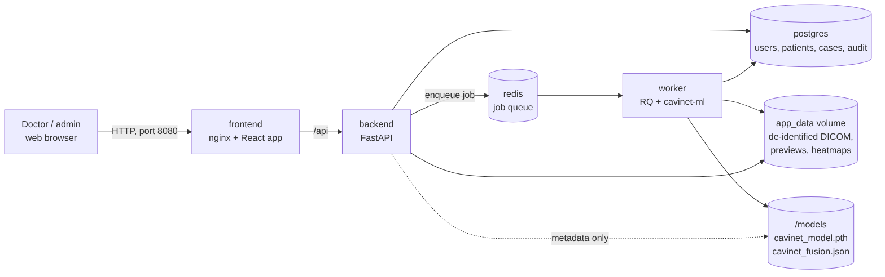
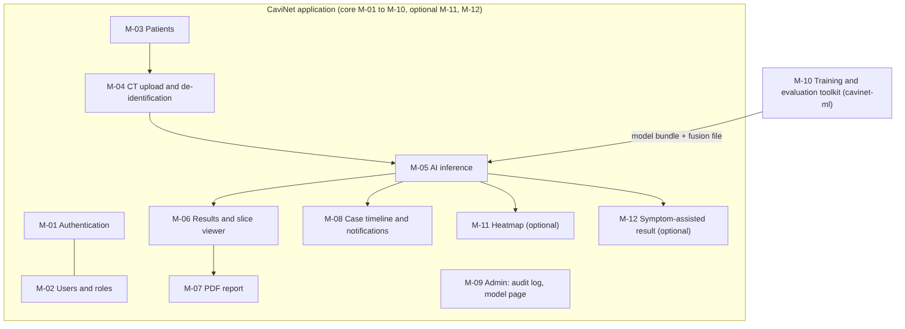
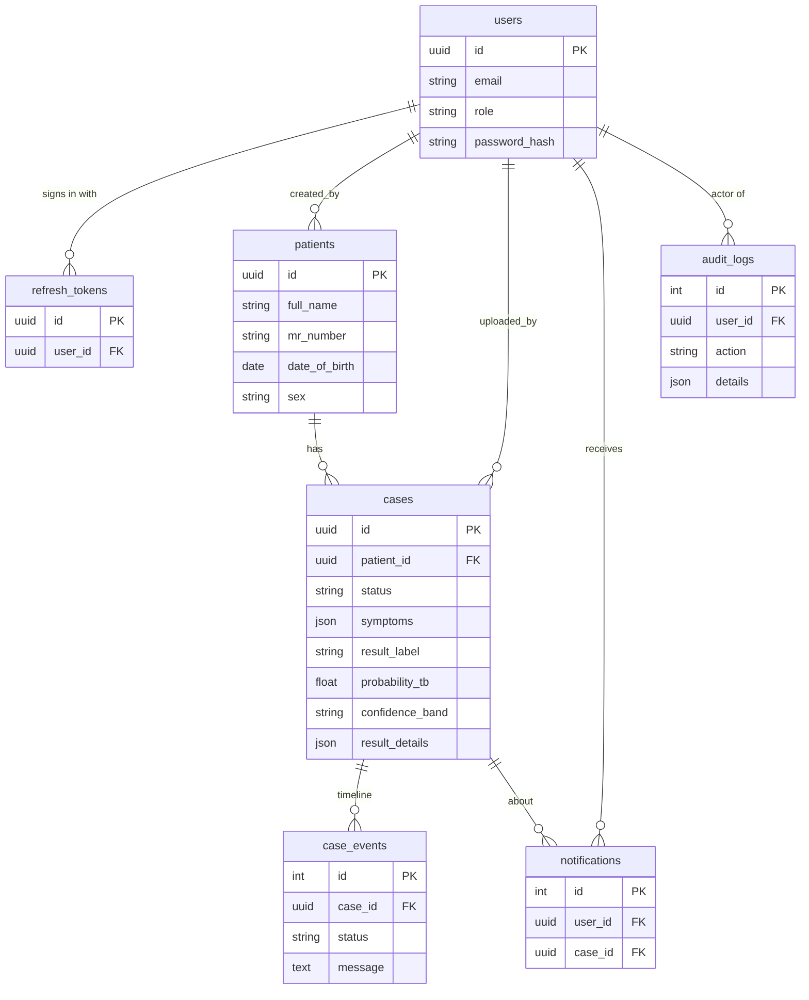
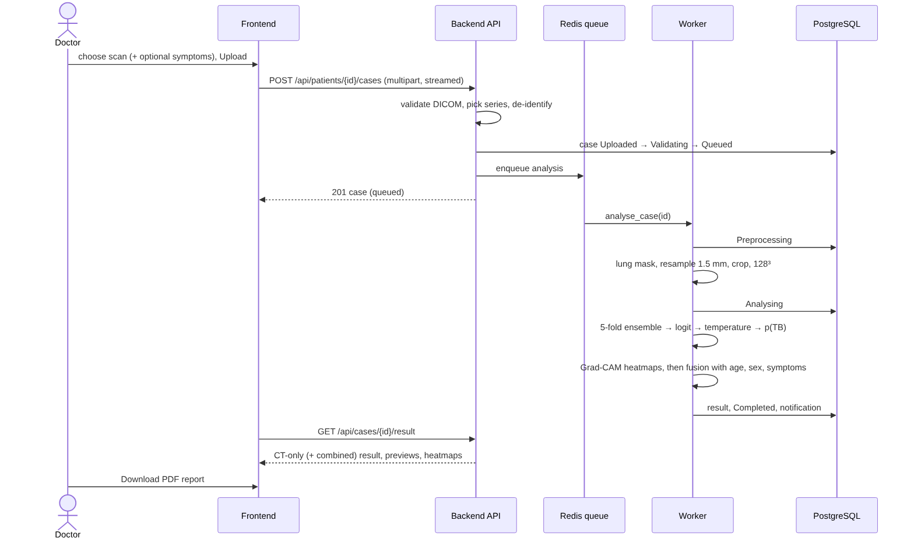

# Thesis support pack

Everything the thesis and the viva need about the delivered system (CaviNet v1.2), in one place.
Numbers are copied from the evaluation outputs; the linked files are the evidence.

| Document | Contents |
|---|---|
| [HYPOTHESES.md](HYPOTHESES.md) | H1 to H5: outcome and evidence for each |
| [METHODS.md](METHODS.md) | The AI pipeline written up for the methods chapter |
| [LIMITATIONS.md](LIMITATIONS.md) | What the results do and do not show |
| [../VIVA_DEMO_SCRIPT.md](../VIVA_DEMO_SCRIPT.md) | Step-by-step demo for the viva, with a fallback |

## Diagrams

Mermaid sources (`.mmd`, editable) and PNG exports in [diagrams/](diagrams/). To re-export after
editing a source: `npx -p @mermaid-js/mermaid-cli@11.4.2 mmdc -i <file>.mmd -o <file>.png -b white -s 2`.

| Diagram | Shows |
|---|---|
|  [architecture](diagrams/architecture.mmd) | The five Docker services and where data lives |
|  [modules](diagrams/modules.mmd) | Modules M-01 to M-12 and how they connect |
|  [database](diagrams/database.mmd) | Database tables and relations |
|  [analysis sequence](diagrams/analysis_sequence.mmd) | One scan from upload to PDF report |

## Evaluation figures and tables

- Full report: [../EVALUATION_REPORT.md](../EVALUATION_REPORT.md); model card: [../MODEL_CARD.md](../MODEL_CARD.md).
- Figures in [../figures/](../figures/): ROC (development and test), reliability (development and
  test), confusion matrix, score histogram, subgroup AUCs and training curves.
- Thesis tables in [../tables/](../tables/TABLES.md) (CSV and Markdown): dataset, folds,
  cross-validation, test metrics, baselines, subgroups, hypotheses.
- Raw audit files in [../audit/](../audit/): every locked-test run, the H3 and H4 results.
- Application check on 10 real scans: [../verification/MODEL_VERIFICATION.md](../verification/MODEL_VERIFICATION.md).
